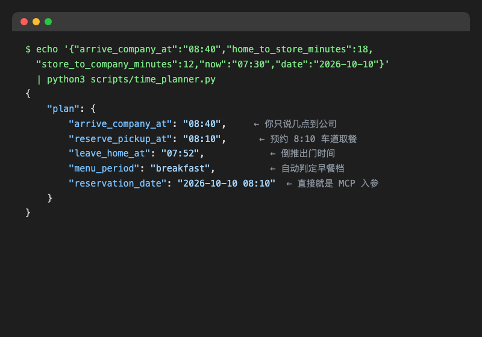

# 通勤得来速管家（mcd-drivethru-buddy）

> 麦当劳程序员创意开发大赛参赛作品 · 基于麦当劳 MCP Server 的 Agent Skill

每天开车上班的你，是不是都经历过这个纠结：

- 想买份麦当劳早餐，但进店停车、排队、点单，一套下来迟到预警；
- 提前在 App 下单吧，又得掐着时间算"几点下单、几点到店、餐会不会凉"；
- 到了公司才发现，沿途那家店根本不支持得来速，白绕了八分钟。

**通勤得来速管家**把这一串心算变成一句话的事。告诉你的 AI 助手：

> 「我 8:40 到公司，路上想吃老样子，帮我安排一下。」

它会自动完成：**沿途找得来速门店 → 倒推预约取餐时间 → 从历史订单认出你的"老样子" → 领券核价 → 你点头后创建得来速预约单 → 展示取餐码**。你只管开车，到点摇下车窗，拿了就走。

## 它解决了什么问题

| 通勤痛点 | 管家怎么做 |
| --- | --- |
| 不知道沿途哪家店顺路 | `query-nearby-stores` 查门店，Python 脚本按**绕行分钟数 / 是否得来速 / 是否支持预约**打分排序 |
| 怕算错时间迟到 | 时间计算全部交给**确定性 Python 脚本**倒推：几点出门、几点预约取餐、赶不赶得上早餐档，AI 不口算 |
| "老样子"三个字说不清 | 读 `order-list` 历史订单，脚本统计出你最常点的组合、常去的店、惯常下单时段 |
| 券多不会用 | 先用本地脚本预估最优券，再调 `calculate-price` 权威核价，省多少一目了然 |
| 怕 AI 乱下单 | 领券、下单、取消**全部有确认门控**，金额和取餐时间摆出来你点头才算数 |

## 目标用户

- 每天开车通勤、顺路想买麦当劳早餐/咖啡的打工人；
- 时间卡得死、不想为取餐多绕一分钟路的效率控；
- 想把"找店—算时间—领券—下单"浓缩成一句口播的 AI 助手重度用户。

## 安装与接入

1. 到 [麦当劳 MCP 开放平台](https://open.mcd.cn/mcp) 申请 MCP Token（手机号登录 → 控制台 → 激活）。
2. 把 Token 配进环境变量：

```bash
export MCD_MCP_TOKEN="你的Token"
```

3. 在支持 streamablehttp 的 MCP Client（WorkBuddy / Cursor / Cherry Studio / Trae / VSCode 等）中参考 `mcp-config.example.json` 接入麦当劳 MCP Server。
4. 把本目录的 `SKILL.md` 作为 Skill 加载到你的 AI 助手（各 Client 的 Skill 加载方式见对应文档），助手即获得完整通勤点餐流程。

## 使用示例

```
你：我 8:40 到公司，路上想吃老样子，帮我安排一下。

AI：查到你最常点的是「猪柳蛋麦满分 + 咖啡阿芙佳朵」（近 4 单里出现 3 次）。
    沿途 5 家得来速，推荐【上海老沪闵路得来速餐厅】：只绕行 4 分钟，
    支持预约，明天早餐窗口 07:14-10:15，你的取餐时间落在窗口内。
    时间已排好：7:52 出门 → 预约 8:10 车道取餐 → 8:25 前出发去公司，还能赶上早餐档。
    用「满 30 减 5」券后应付 28.00 元（已比过 88 折方案，省更多）。
    需要我先帮你一键领取麦麦省可领的券，然后按这个方案下单吗？

你：可以，下单吧。

AI：✅ 得来速预约单已创建：8:10 上海老沪闵路得来速餐厅车道自提，取餐码 XXXX。
    记得 7:52 出门，到取餐车道报取餐信息即可。
```

## 离线演示（无 Token）

没有 Token 也能体验完整逻辑——所有计算脚本均可用内置样例数据运行：



```bash
# 时间倒推：8:40 到公司，算出预约取餐/出门时间、菜单时段和 MCP 预约入参
echo '{"arrive_company_at":"08:40","home_to_store_minutes":18,"store_to_company_minutes":12,"now":"07:30","date":"2026-10-10"}' \
  | python3 scripts/time_planner.py

# 门店打分排序（真实门店快照）
python3 -c "import json,sys; sys.path.insert(0,'scripts'); from sample_data import SAMPLE_STORES; print(json.dumps({'stores':SAMPLE_STORES},ensure_ascii=False))" \
  | python3 scripts/store_ranker.py

# 券方案比价（真实菜单餐品 + 归一化券规则）
python3 -c "import json,sys; sys.path.insert(0,'scripts'); from sample_data import SAMPLE_COUPON_RULES; print(json.dumps({'items':[{'code':'5022','name':'猪柳蛋麦满分','price':18.0,'quantity':1},{'code':'514851','name':'咖啡阿芙佳朵','price':15.0,'quantity':1}],'coupons':SAMPLE_COUPON_RULES},ensure_ascii=False))" \
  | python3 scripts/price_planner.py

# 从历史订单学"老样子"（order-list 真实结构样例）
python3 -c "import json,sys; sys.path.insert(0,'scripts'); from sample_data import SAMPLE_ORDERS; print(json.dumps({'orders':SAMPLE_ORDERS},ensure_ascii=False))" \
  | python3 scripts/order_learner.py
```

样例数据不是拍脑袋编的：`scripts/sample_data.py` 是 **2026-10-09 用真实 MCP Token 联调采集的结构快照**——上海 5 家真实得来速门店（含各自预约时段窗口）、真实早餐菜单餐品编码、真实核价返回（金额单位为分）、真实历史订单结构。字段名与线上保持一致，联调前即可放心开发。

## 设计原则：数字归脚本，对话归 AI

LLM 擅长对话和编排，但算时间、算钱容易"想当然"。本项目把所有数字逻辑钉死在**零第三方依赖的 Python 脚本**里：

| 脚本 | 职责 |
| --- | --- |
| `scripts/time_planner.py` | 由到公司时间倒推预约取餐时间、出门时间，判断早餐/正餐时段，输出"来不及"等预警 |
| `scripts/store_ranker.py` | 门店多维度打分排序，权重可调，硬过滤未营业/不支持得来速的店 |
| `scripts/price_planner.py` | 金额以"分"为单位整数运算，预估最优用券方案（权威金额仍以 `calculate-price` 为准） |
| `scripts/order_learner.py` | 从历史订单统计最常点组合、常去门店、惯常下单时段 |
| `scripts/sample_data.py` | dry-run 与单测共用的真实结构快照（2026-10-09 联调采集） |

AI 只负责理解你说话、编排 MCP 工具、展示方案和守护确认门控。

## 运行测试

```bash
python3 -m unittest discover -s tests -v
```

全部测试离线运行，不依赖 Token 与网络。

## 目录结构

```
mcd-drivethru-buddy/
├── README.md                  # 本文件
├── SKILL.md                   # Agent Skill：教 AI 编排 MCP 工具 + 确认门控
├── MCP_INTEGRATION.md         # MCP 工具使用说明与调用流程
├── CONTEST_DECLARATION.md     # 参赛声明
├── mcp-config.example.json    # 脱敏配置示例
├── scripts/                   # 零依赖 Python 确定性计算脚本
│   ├── time_planner.py
│   ├── store_ranker.py
│   ├── price_planner.py
│   ├── order_learner.py
│   └── sample_data.py
└── tests/                     # 离线单元测试
```

## 边界与声明

- 以下关键点已于 2026-10-09 用真实 Token 联调验证：`beType`/`orderType` 枚举语义、`reservationDate` 格式（`yyyy-MM-dd HH:mm`）、核价金额单位（分）、得来速取餐码 `takeWayCode=take-dt-quick`、门店/菜单/券/历史订单字段结构。
- 尚未实测的环节：`create-order` 真实下单与 `query-order` 状态流转（消耗性操作，需用户在场确认后联调）。
- 路况与绕行时间是估算值：脚本只做确定性算术，不接实时路况，实际以导航为准。
- 券的互斥规则、门槛、时段与"到店/外送"场景限制以券面与 `calculate-price` 返回为准，本地脚本仅做预筛选。
- 本项目为参赛作品，非麦当劳官方产品；餐品、价格、供应状态以麦当劳官方渠道实时结果为准。
